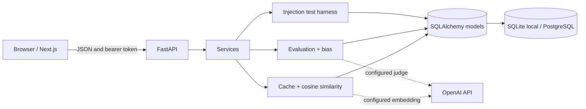

# LLM Reliability Lab

LLM Reliability Lab is a small engineering workspace for testing semantic-cache behavior, judging model responses, comparing answers for bias signals, and exercising a prompt-injection harness. It is a local-first modular monolith built with Next.js, FastAPI, SQLAlchemy, and Alembic.

> This is an engineering/evaluation MVP. Demo scoring is a transparent lexical heuristic; the security harness is pattern-based. Neither is a factuality or security guarantee.

## Screenshots

<!-- Add current screenshots here after running the app locally. -->

## Features

- **Semantic cache and benchmarks:** namespace isolation, exact matching in demo mode, OpenAI embeddings for configured semantic matching, TTL/invalidation, bounded candidate scans, measured local lookup time and provider-reported embedding token use, plus explicitly estimated avoided calls/cost.
- **Evaluation and bias diagnostics:** schema-validated OpenAI judge outputs or clearly labeled deterministic demo scores, configurable criterion weights, candidate order swaps, and repeated scoring.
- **RAG security harness:** sample and custom test cases, heuristic matched-rule explanations, false-positive/negative counts, saved results, and visible coverage limitations.
- **Unified experiments:** benchmark, evaluation, bias, and security runs are saved to shared history with detail views for metrics and results.
- **Settings and operations:** runtime provider status, browser-tab bearer token entry, cache/data reset, health/readiness endpoints, and JSON request logs that omit prompts and credentials.

## Architecture



See [docs/architecture.md](docs/architecture.md) for request lifecycles and data models.

## Technology

- Python 3.11+; FastAPI, Pydantic v2, SQLAlchemy 2, Alembic, HTTPX, psycopg 3.
- Node.js 20+; Next.js, React, TypeScript, Vitest, Testing Library.
- SQLite for local development/tests; PostgreSQL for hosted deployment.
- Docker Compose with SQLite by default and opt-in local PostgreSQL.

## Start locally

Detailed commands are in [docs/setup.md](docs/setup.md). Quick path:

```bash
cd apps/api
cp -n .env.example .env
python3.11 -m venv .venv
source .venv/bin/activate
pip install -r requirements.txt
alembic upgrade head
uvicorn app.main:app --reload
```

In another terminal:

```bash
cd apps/web
npm ci
npm run dev
```

Use `http://localhost:3000`; API health and docs are at `http://localhost:8000/api/v1/health` and `http://localhost:8000/docs`. The API example points to a new `llm_reliability_local.db` file so it does not silently alter the checked-in legacy database.

## Docker

```bash
cp -n .env.example .env
docker compose config
docker compose up --build
```

The default stack persists a separate SQLite database in a named volume. Use [docs/docker.md](docs/docker.md) for optional PostgreSQL, checks, data persistence, and safe reset instructions. Docker is unavailable in the implementation environment; images and container behavior have not been verified here.

## Configuration and providers

API secrets are server-side only. To use OpenAI, set `LLM_PROVIDER=openai` and/or `EMBEDDING_PROVIDER=openai` and provide `OPENAI_API_KEY` in the API environment. Demo mode must be `false` to select hosted providers; it then requires a 32+ character `APP_ACCESS_TOKEN` and PostgreSQL `DATABASE_URL`. The browser only receives `NEXT_PUBLIC_API_BASE_URL`, never provider or database credentials.

Configuration examples are in `apps/api/.env.example`, root `.env.example` (Compose), and `apps/web/.env.example`. Detailed local setup is in [docs/setup.md](docs/setup.md).

## Database and existing data

For a fresh database, run `alembic upgrade head`. Never stamp an existing SQLite database without backing it up and verifying its schema against revision `0001_initial`; legacy local databases may require `alembic stamp 0001_initial` followed by `alembic upgrade head`. The API fails fast when it detects an outdated cache schema. Full migration guidance is in [docs/setup.md](docs/setup.md) and [docs/docker.md](docs/docker.md).

## Tests

```bash
cd apps/api
PYTHONPATH=. python -m pytest -q
cd ../web
npm test
npm run lint
npm run build
```

Provider HTTP is mocked in automated tests. No live OpenAI calls, managed PostgreSQL, Docker runtime, Playwright E2E suite, or cloud deployment were verified. TypeScript checking runs as part of `next build`; there is no standalone typecheck script.

## Future deployment layout

The documented target is a static/container Next.js frontend (Vercel or a container host), FastAPI in Docker on AWS EC2, Supabase PostgreSQL, OpenAI from the backend, and HTTPS termination at a reverse proxy/ingress. No AWS resources were created and no deployment has occurred. Read [docs/deployment.md](docs/deployment.md) before configuring a hosted environment.

## Known limitations

- One shared bearer token is not user identity, workspace isolation, or per-user audit logging.
- The built-in rate limiter is process-local; use shared edge limits for multiple instances. Put the app behind HTTPS and network access controls.
- The request middleware limits streamed bodies, but a reverse proxy should also enforce body/time limits.
- Cache-disabled downstream calls and avoided cost are estimates; the benchmark does not send LLM requests. Lookup latency is measured locally.
- Embedding token usage is reported only when the provider returns usage; embedding cost is an estimate based on the separate `EMBEDDING_COST_PER_MILLION` setting.
- Demo evaluation is lexical and the security harness checks a small pattern set. Test the actual application/RAG pipeline before relying on results.
- Provider responses are mocked in tests; live credentials/model availability, managed PostgreSQL behavior, Docker and cloud deployment remain to be verified.

## Learning path

Start with [docs/learning-guide.md](docs/learning-guide.md), then use the file-by-file [architecture guide](docs/architecture.md). Common failures and fixes are in [docs/troubleshooting.md](docs/troubleshooting.md).
