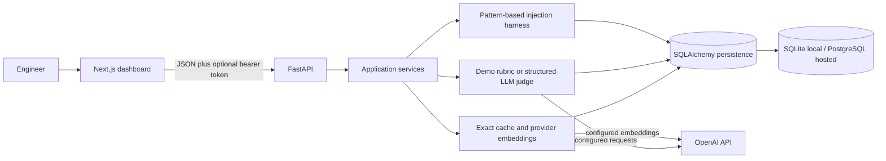

# Architecture and operational boundaries

The project is a modular monolith. Next.js owns presentation and a centralized browser API helper. FastAPI owns validation, request IDs, access-token checks, rate limiting, provider lifecycle, and versioned routes. Use-case functions in `app/services.py` implement cache behavior, scoring, injection classification, and experiment creation. SQLAlchemy models and Alembic own persistence and schema evolution. `app/providers.py` isolates OpenAI HTTP calls from routes.

## Important request paths

- Cache rows can contain no embedding (exact-only mode) or a provider embedding with a model identifier. Similarity comparisons only use rows created by the currently selected embedding model. Expired and invalidated rows are excluded; SQL candidate retrieval is capped by `CACHE_SCAN_LIMIT`.
- Evaluation and pairwise bias calls use structured output from the selected provider. Demo mode uses explicit deterministic heuristics. Provider timeouts and upstream failures become safe 504/502 responses; the API does not log request content or provider error bodies.
- A security run inserts one `SecurityRecord` and one `Experiment` in one database transaction. Session dependencies roll back exceptions and always close sessions.
- Application logs are JSON request events containing request ID, method, path, status, duration, and exception class. Readiness probes check a database connection; liveness remains independent of the database.
- Browser GET requests are deduplicated while identical requests are in flight. The initial overview uses the summary endpoint's recent records; history and settings are fetched only when opened.

## API surface

- `GET /api/v1/health`, `GET /api/v1/ready`, `GET /api/v1/settings`
- `POST /api/v1/cache/lookup`, `POST /api/v1/cache`, `GET /api/v1/cache/stats`, `DELETE /api/v1/cache`, `DELETE /api/v1/cache/{entry_id}`
- `POST /api/v1/benchmarks`
- `POST /api/v1/evaluations`, `GET /api/v1/evaluations`, `GET /api/v1/evaluations/export?format=json|csv&limit=200&offset=0`
- `POST /api/v1/bias-tests`
- `GET /api/v1/security/sample-cases`, `POST /api/v1/security/runs`
- `GET /api/v1/experiments`, `GET /api/v1/experiments/summary`, `GET /api/v1/experiments/{id}`, `DELETE /api/v1/experiments`, `DELETE /api/v1/experiments/{id}`
- `DELETE /api/v1/settings/demo-data`

FastAPI publishes OpenAPI at `/docs` and `/openapi.json`. Non-demo API routes require a shared bearer token. Health and readiness endpoints are exempt so infrastructure probes can access them.

## Schema and operations

Alembic revision `0001_initial` creates the original schema. `0002_provider_cache` allows exact-only cache entries and adds embedding model provenance. Existing unversioned databases must be backed up, verified against revision 0001, stamped at that revision, and upgraded. Production startup does not call `create_all`; it fails fast if the cache schema is outdated. Local demo startup creates missing SQLite tables only.

The application limiter is bounded but process-local. Multiple workers need edge/shared rate limiting. The body-length middleware rejects oversized declared `Content-Length`; the reverse proxy must also cap actual streamed bodies. The shared token does not provide user identities, tenant isolation, or per-user quotas. Deploy behind HTTPS, a restrictive network boundary, a shared edge limiter, and managed PostgreSQL backups.

## Known limits

1. The security detector is a small pattern-based harness, not a production prompt-injection defense.
2. Demo evaluation is a heuristic and must not be interpreted as model-judged quality.
3. Cache hit savings are estimates; only lookup latency is measured directly. Token cost depends on manually configured pricing assumptions.
4. Provider behavior is tested with mocked HTTP responses; live credentials, billing, rate limits, and provider model availability require deployment-side validation.
5. PostgreSQL migrations and behavior have not been validated against a managed production instance.
6. There is no identity provider, user management, per-tenant data isolation, distributed rate limiter, or cloud deployment manifest.
