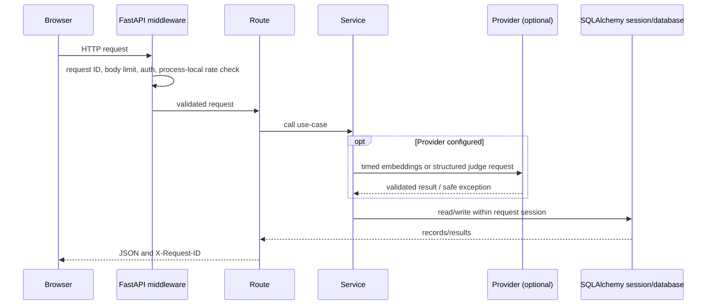
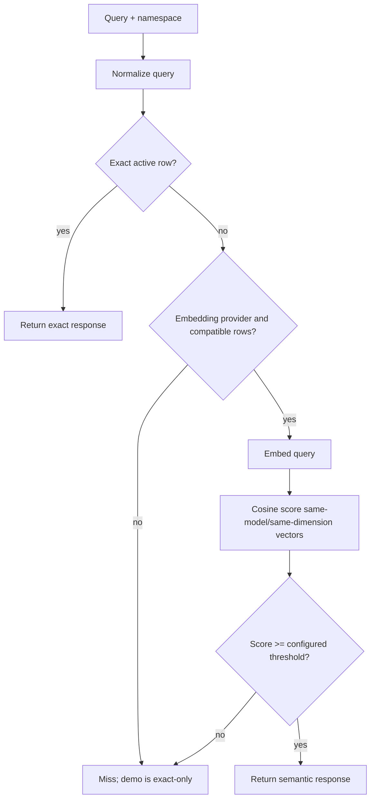
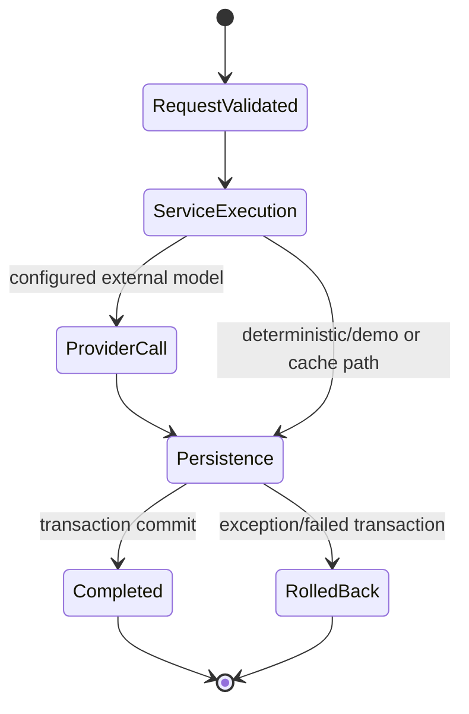

# Architecture guide

The application is a modular monolith with one Next.js dashboard and one FastAPI process. API contracts are under `/api/v1`; use cases live in `apps/api/app/services.py`; external OpenAI HTTP calls are isolated in `providers.py`; SQLAlchemy models use Alembic migrations.

## Frontend

The single dashboard route is `apps/web/src/app/page.tsx`; layout and metadata are in `layout.tsx`, global/responsive styles in `globals.css`, and component/integration behavior in `page.test.tsx`. Navigation changes the active workspace module without a full page load. The `api()` helper adds JSON accept headers, the tab-local bearer token, safe error parsing, and in-flight GET deduplication. History and Settings fetch when opened; summary fetches on initial overview. Saved experiment rows call `/experiments/{id}` and display persisted configuration, metrics, and results.

The browser needs a browser-reachable `NEXT_PUBLIC_API_BASE_URL`; Compose's internal `api` hostname is not available to a user's browser. OpenAI keys, database URLs, and app tokens are never `NEXT_PUBLIC_*` build variables. CSV export uses an authenticated fetch and browser Blob download.

## Backend request lifecycle

`app/main.py` contains versioned routes, lifecycle, middleware, error translation, and JSON request logging. Request logs include request ID, method, route, response status, duration, and exception type; they omit request bodies, authorization headers, provider response details, and environment values. `get_db()` in `db.py` rolls back an uncaught exception and always closes its session. SQLAlchemy errors return a safe 503; provider timeout/rate-limit/upstream failures return safe 504/503/502 responses.

## Dependency injection and validation

FastAPI injects `Session` with `Depends(get_db)`. Request schemas in `schemas.py` bound input lengths, case counts, criterion keys/weights, and categories before route logic. `Settings` in `config.py` validates production combinations and provider endpoint allowlists at import/startup. In production (`DEMO_MODE=false`) the shared bearer token and PostgreSQL are required, plus at least one real provider. Health/readiness and the API schema/docs are unauthenticated; data and mutation routes pass through the auth middleware.

## Database design

`models.py` defines:

- `CacheEntry`: normalized text, namespace, optional vector, embedding model/dimension identity, TTL, and invalidation flag.
- `Experiment`: unified run type/name/status/configuration/metrics/results/timestamps.
- `EvaluationRecord`: prompt/reference/candidate, criterion scores, aggregate, timestamp.
- `SecurityRecord`: case and attack outcome counts plus full run results.

Experiments also retain result payloads so history works across cache benchmark, evaluation, bias, and security workflows. Security/evaluation result records and their experiment rows are inserted in the same transaction. The migrations are `0001_initial` and `0002_provider_cache`; fresh installs use `alembic upgrade head`. Legacy unversioned data must be backed up and verified against `0001_initial` before stamping. Startup does not auto-upgrade or reset schemas; it fails fast on the known old cache schema. SQLite remains supported for development; PostgreSQL URLs are normalized to psycopg and optional SSL mode is applied by `db.py`.

## Semantic caching

`services.cache_store()` generates a vector only when a real embedding provider was passed. `cache_lookup()` filters namespace, TTL, invalidation, and scan limit; exact matching is tried before embeddings. Provider identity includes embedding model and dimensions; incompatible old vectors are skipped. `cosine()` normalizes vectors and rejects size mismatch/zero vectors. OpenAI implementation is `OpenAIProvider.embed()` in `providers.py`. Tests inject fake vectors; those are test doubles, not a real provider verification.

The benchmark route runs a small fixed query set against the configured cache and measures lookup wall time. It computes an exact-only comparison locally. It does not run an LLM for the cache-disabled counterfactual: disabled downstream calls, avoided calls, and avoided cost are estimates; only cache lookup time is measured. Embedding token usage is included when the provider returns it; embedding cost uses the separate `EMBEDDING_COST_PER_MILLION` assumption. Judge and embedding prices are estimates, not provider invoices.

## Evaluation and bias flow

`POST /evaluations` accepts prompt/candidate/reference and optional criterion weights. The weights are validated and normalize the aggregate across five criteria. `services.evaluate()` uses `OpenAIProvider.judge_response()` when configured; strict JSON-schema response is checked by Pydantic `JudgeScores`. Otherwise it returns explicitly labeled lexical demo scores. The explanation/rationale, model/judge identity, usage (for provider calls), estimated configured token cost, and scores are stored in experiment results.

`POST /bias-tests` makes pairwise decisions in original and swapped candidate order, then repeats candidate scoring. It reports selection stability, candidate word counts, and score variation. These few calls are descriptive probes, not statistically supported bias measurements. Demo decisions use a lexical rule and are labeled as such.

## Security harness flow

`GET /security/sample-cases` returns four example inputs. `POST /security/runs` accepts 1–100 validated categories/cases; the dashboard also accepts a custom JSON list. `services.matching_injection_rules()` reports which small configured regex patterns matched; `run_security()` compares pattern outcomes against the case's supplied malicious label, calculates false positives/negatives, and stores explanations with one `SecurityRecord` and one `Experiment` atomically.

The harness does not call a protected model/RAG pipeline, does not execute retrieved text, and has no comprehensive adversarial corpus. A no-match result is explicitly not evidence that input is safe. It is a test harness only.

## Experiment lifecycle

Routes create an `Experiment`, flush/commit with their related result records, then return IDs. Errors do not get persisted as failed experiments currently; transaction failures roll back all rows for that request. Listing is paginated/bounded, summary uses aggregate queries, and detail returns one saved run. Browser row selection fetches detail on demand.

## Operational limits

- Shared static bearer token: no identities, tenant isolation, token expiry/rotation workflow, or per-user quotas.
- Rate limiter is in-memory per worker; configure shared edge limiting before multiple instances.
- Middleware enforces streamed request size; reverse proxy should also cap request sizes and durations.
- External OpenAI and PostgreSQL behavior are not live-verified by automated tests.
- See [deployment.md](deployment.md), [docker.md](docker.md), and [troubleshooting.md](troubleshooting.md) for operations.
