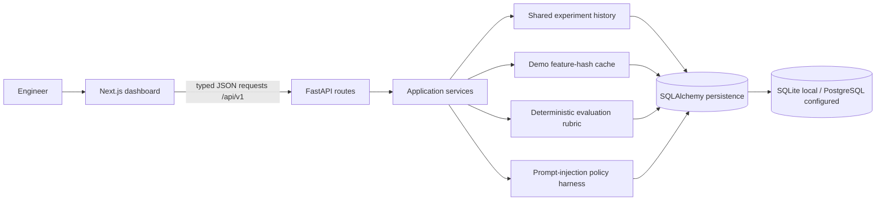

# Architecture and technical boundaries

The project is a modular monolith. Next.js owns presentation and calls a centralized browser API helper. FastAPI owns validation, HTTP errors, and versioned routes. Use-case functions in `app/services.py` implement cache, deterministic rubric, injection classification, and experiment creation. SQLAlchemy models and session setup own persistence. Provider work is isolated from route concerns; this first deliverable registers only explicitly labeled deterministic demo behavior.

## API surface

- `GET /api/v1/health`
- `POST /api/v1/cache/lookup`, `POST /api/v1/cache`, `GET /api/v1/cache/stats`, `DELETE /api/v1/cache`, `DELETE /api/v1/cache/{entry_id}`
- `POST /api/v1/benchmarks`
- `POST /api/v1/evaluations`, `GET /api/v1/evaluations`, `GET /api/v1/evaluations/export?format=json|csv`
- `POST /api/v1/bias-tests`
- `GET /api/v1/security/sample-cases`, `POST /api/v1/security/runs`
- `GET /api/v1/experiments`, `GET /api/v1/experiments/summary`, `GET /api/v1/experiments/{id}`, `DELETE /api/v1/experiments`, `DELETE /api/v1/experiments/{id}`

FastAPI publishes OpenAPI at `/docs` and `/openapi.json`. Requests have an `X-Request-ID` response header. API payloads are capped at 1 MB and schemas constrain individual text fields.

## Limitations and next work

1. Add real embedding and LLM adapters with timeouts, secret handling, provider health checks, and test doubles before using provider-backed results.
2. Replace demo feature hashing with a documented local embedding model or hosted vector store; the current token-feature projection is not semantic understanding.
3. Complete the benchmark's disabled and exact-only baselines using independent request paths and add a configurable dataset/pricing profile.
4. Implement versioned persistent evaluation datasets, compare outputs, richer rubric calibration, and repeated judge configurations.
5. Harden security classification with a maintained attack corpus and measured false-positive/negative ground truth. The current pattern detector is intentionally small.
6. Add bounded rate limiting, authentication for public deployment, and production request logging/metrics. Current body size and CORS restrictions do not constitute full public-service protection.
7. Add frontend automated tests and richer charts; current dashboard avoids fabricating values and exposes stored run metrics.
8. Validate migrations and PostgreSQL behavior against the target hosting service before launch.
