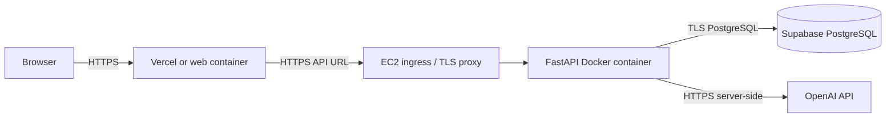

# Future deployment guide

This guide describes a deployment plan; nothing has been deployed and no AWS resources have been created. Start with a staging environment and a disposable database.

## Target topology

## Supabase PostgreSQL

1. Create a database/project and database role in Supabase yourself.
2. Choose a connection endpoint appropriate for the host (direct or session pooler). Ensure the connection pool size is within the plan's connection limit.
3. Store `DATABASE_URL` in the backend secret store. URL-encode reserved characters in credentials.
4. Set `DATABASE_SSL_MODE=require` or the mode required by your selected Supabase endpoint. Use certificate verification according to provider guidance.
5. Before app instances start, run a one-shot release task using the same image and environment: `alembic upgrade head`.
6. Enable backups/retention and restrict network access where the plan supports it.

Do not add Supabase credentials to frontend build variables, Git, Docker build arguments, or logs.

## FastAPI on AWS EC2 (planned)

1. Build and scan the pinned API Docker image in CI. Publish it to a registry you control.
2. Provision an EC2 instance and least-privilege instance role. Use a security group that allows HTTPS only from the intended ingress and SSH only from a controlled administration source; do not expose PostgreSQL to the public internet.
3. Install Docker Engine and Compose v2, configure automatic security updates, and create a non-root deployment account.
4. Provide `DATABASE_URL`, `DATABASE_SSL_MODE`, `DEMO_MODE=false`, a random `APP_ACCESS_TOKEN`, exact `CORS_ORIGINS`, `LLM_PROVIDER`/`EMBEDDING_PROVIDER`, and `OPENAI_API_KEY` through a secret manager or protected environment file with restrictive permissions.
5. Run the migration job once, then start one API worker initially. The app's built-in limiter is per process; put a shared rate limit at the ingress before increasing replicas.
6. Terminate TLS at a managed load balancer or maintained reverse proxy. Set request body/time limits, forward only trusted proxy headers, and bind container ports privately. Open only 443 publicly.
7. Monitor health checks, restart events, CPU/memory, database pool errors, and provider 429/5xx responses. Configure log retention and backups.

The current API uses a shared bearer token. It does not provide accounts, tenant separation, or per-user audit identity. Do not expose it as a general public multi-tenant service without adding a suitable identity/authorization layer.

## Frontend hosting

### Vercel

- Set the project root to `apps/web`, install using `npm ci`, and build using `npm run build`.
- Set `NEXT_PUBLIC_API_BASE_URL` to the browser-reachable HTTPS API URL plus `/api/v1` before build.
- Configure the FastAPI `CORS_ORIGINS` to the exact public Vercel origin.
- Do not add OpenAI or database secrets to Vercel frontend variables.

### Container frontend

- Use the root Compose setup or publish the web image.
- Pass `BROWSER_API_BASE_URL` as a build argument; Next.js embeds this public value at build time. Rebuild after changing it.
- Configure the browser-reachable HTTPS API URL; the current dashboard calls the API directly from the browser.
- Place it behind HTTPS ingress and set exact CORS origin on the API.

## Secrets, cost, and operations

- Rotate the shared token and provider key through the secret store; recreate API containers after rotation.
- Restrict OpenAI project spend and usage according to the provider's current controls. Estimated cache savings are not billed-cost measurements.
- Use separate staging/production databases and backup retention. Test restore procedures before production changes.
- Run database migrations as one controlled release task, not in every worker.
- Set `DB_POOL_SIZE` and `DB_MAX_OVERFLOW` according to the Supabase limit and number of API instances.
- Ensure the reverse proxy enforces streamed body limits; app middleware is a secondary bound.
- Keep liveness/readiness endpoints reachable by the platform, but protected operational/data endpoints behind app auth/network controls.

## Rollout checklist

1. Verify `alembic current` after release migration.
2. Call `/api/v1/health` and `/api/v1/ready` from the deployment network.
3. Submit a cache lookup, evaluation, and security sample with disposable content.
4. Confirm browser CORS and bearer-token behavior.
5. Confirm experiments persist across API restart and restore from backup in staging.
6. Inspect logs for errors and confirm no prompts, tokens, or provider secrets appear.
7. Record which real provider models and prices were configured; test a real provider call and billing separately.

These are future operator steps, not checks completed by this repository task.
