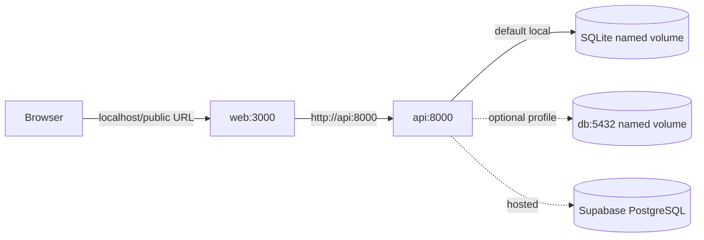

# Docker development and deployment notes

## Requirements

Install Docker Desktop (Mac/Windows) or Docker Engine plus the Compose v2 plugin (Linux). This repository's Docker setup was authored for those tools; run `docker --version` and `docker compose version` before starting. The API container is Python 3.13; the web image uses Node.js 22 LTS. Docker runs migrations before starting the API worker.

## Local demo with SQLite

```bash
cp .env.example .env
docker compose config
docker compose up --build
```

Open http://localhost:3000, API docs at http://localhost:8000/docs, liveness at http://localhost:8000/api/v1/health, and database readiness at http://localhost:8000/api/v1/ready. The browser uses `BROWSER_API_BASE_URL` (default `http://localhost:8000/api/v1`); the Next.js server uses `INTERNAL_API_BASE_URL=http://api:8000/api/v1`. `api` is a Compose DNS name and is not reachable from a user's browser. Set both appropriately if the browser and host use another hostname.

SQLite is persisted in the named `api_data` volume at `/data/llm_reliability.db`. API migrations are run on startup. The old checked-in SQLite database is excluded from the image; if migrating that file, copy it into the volume using a deliberate backup/migration procedure first. See README migration notes.

## Local PostgreSQL profile

Add a strong, unique local password as `POSTGRES_PASSWORD` in `.env`, then start the opt-in database profile:

```bash
docker compose --profile postgres up --build
```

The PostgreSQL service is named `db`. The API connects using the internal URL `postgresql+psycopg://reliability:<URL-encoded-password>@db:5432/reliability`. Set `DATABASE_URL` in `.env` to that URL and set `DEMO_MODE=true` for local demo behavior. The database is persisted in `postgres_data`. Its host port is bound to `127.0.0.1` by default for local tools; do not publish database ports in a production environment.

To keep SQLite and Postgres from sharing one named volume incorrectly, select the database explicitly before startup. Compose environment interpolation example:

```dotenv
DATABASE_URL=postgresql+psycopg://reliability:YOUR_URL_ENCODED_PASSWORD@db:5432/reliability
```

The API starts only after Alembic succeeds. It uses one Uvicorn worker in this Compose configuration so migrations are not run by multiple application workers. For an external migration release step, run `docker compose run --rm api alembic upgrade head` before bringing up scaled API instances.

## Supabase PostgreSQL

Do not run the `db` profile for Supabase. Set the backend `DATABASE_URL` to the Supabase connection URI (prefer the provider's direct/session connection option compatible with long-lived SQLAlchemy pooling). Encode reserved URI characters in the username/password. Set `DATABASE_SSL_MODE=require` if the selected endpoint requires TLS; use `verify-full` with the appropriate CA configuration when that is required by your provider/network policy. The API pool defaults to five persistent connections plus five overflow; reduce `DB_POOL_SIZE` and `DB_MAX_OVERFLOW` to fit the Supabase plan's connection limit. Use one-off migrations before app replicas, and keep DB network restrictions/backups enabled. Do not pass this URL to the web service or any `NEXT_PUBLIC_*` variable.

For production, also set `DEMO_MODE=false`, a random `APP_ACCESS_TOKEN` of at least 32 characters, `CORS_ORIGINS` to the exact public web origin, and configure at least one real provider. Keep provider credentials in your platform's secret manager. Bind published app ports behind a TLS reverse proxy or platform ingress. Docker alone is not a production deployment and the app currently uses shared-token access rather than per-user identity.

## Useful commands

```bash
docker compose ps
docker compose logs -f api web
docker compose logs -f db                         # with postgres profile
docker compose up --build -d                      # rebuild/restart
docker compose restart api
docker compose down                               # stop; named data volumes remain
```

Normal shutdown does not delete data. To reset demo records through the application, use Settings → Reset data (or `DELETE /api/v1/settings/demo-data`). To delete all local database data and volumes, the destructive command is:

```bash
docker compose down -v
```

This irreversibly deletes local SQLite and PostgreSQL volumes. Confirm you have a backup before running it.

## Smoke testing

After startup, in a second terminal:

```bash
docker compose ps
curl -fsS http://localhost:8000/api/v1/health
curl -fsS http://localhost:8000/api/v1/ready
curl -fsS http://localhost:3000/ >/dev/null
curl -fsS http://localhost:8000/api/v1/cache/stats
```

To test persistence, use the UI to store a cache entry and run an experiment, restart the API with `docker compose restart api`, then verify the experiment remains in History. With PostgreSQL, query through an authorized client and confirm Alembic reports head. Docker image builds, inter-container requests, and persistence smoke tests still need to be run on a machine with Docker installed.

## Architecture


